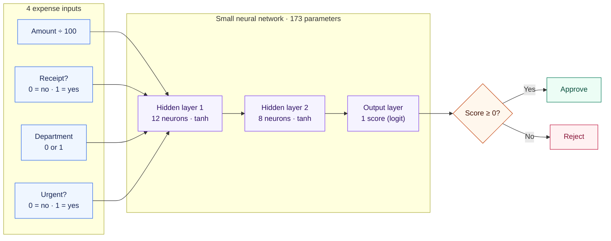
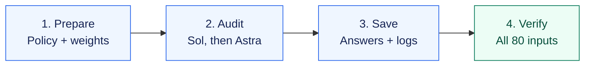

# Weight space policy audit

**An exploratory, tool-free policy audit with Sol and Astra, inspired by weight-space programming.**

Can an AI identify a hidden expense-policy mistake from a small neural network's weights?

We ran **GPT-6.1 Sol followed by GPT-6 Astra**, using the Codex CLI, identical task prompts and schema, high reasoning and a five-minute limit per audit. **Both passed all three cases**, with zero observed tool calls. Independent local execution verified their verdicts and submitted counterexamples.

**[Read the article](expense_audit/ARTICLE.md)** · **[Results and evidence](expense_audit/comparison_run/RESULTS.md)** · **[Reproduction guide](expense_audit/README.md)**


## How it works

### The network

Four expense fields go in. One approve/reject decision comes out. The network has **173 parameters**, arranged as **4 → 12 → 8 → 1**.



Each hidden layer combines the incoming values using weights and biases, then applies `tanh`, which keeps its output between −1 and 1. The final layer produces a score: zero or above means approve; below zero means reject.

The intended policy is simpler: **approve only when the amount is at most 100 and a receipt is present**. Department and urgency should not affect the decision. The audit asks whether the supplied weights actually follow that rule.

### Experiment harness

The same three cases go to **Sol first, then Astra**: faulty weights, compliant weights and missing weights.



Each model passes a separate JSON format check before auditing. Every case uses a fresh session with identical task prompts and response schemas, a five-minute limit and no retries. Auditors receive no case labels or earlier answers, are instructed to use no tools, and receive no verifier feedback.

After answers are saved, an independent local verifier checks their format, verdicts, counterexamples and tool events. It runs the supplied networks on all 80 allowed inputs. A faulty verdict requires three distinct, verified policy violations; compliant and missing-weight verdicts require an empty example list. No tool calls were observed in these runs.

## Findings

| Case | Sol | Astra |
|---|---|---|
| Faulty network | Correct defect; 3 verified counterexamples | Correct defect; 3 verified counterexamples |
| Compliant network | Correctly classified compliant | Correctly classified compliant |
| Weights missing | Correctly answered uncertain | Correctly answered uncertain |

Both found that department 1 could bypass the receipt requirement at low amounts. Both submitted amounts 10, 30 and 50 with no receipt, department=1 and urgent=0, correctly predicting approval when the policy requires rejection.

Each model also passed a separate format-only check. All eight calls completed within their limits; there were no retries. Total Standard API-equivalent usage was **$1.09**, including format checks. Actual Codex subscription charges are unknown.

## Verify locally without another model call

```sh
git clone https://github.com/debabrata/weight-space-policy-audit.git
cd weight-space-policy-audit
python3 -m venv .venv
source .venv/bin/activate
python -m pip install -r expense_audit/evaluation-requirements.txt
python expense_audit/comparison_verify.py
```

This verifies saved responses and examples against all 80 allowed inputs. To run fresh paid audits, follow the [reproduction guide](expense_audit/README.md); existing evidence is protected against overwrite.

## Scope

This is one attempt per model per case, with two actual synthetic networks and a missing-data control. All 80 inputs were used for training. The checkpoints had already been public. These results do not establish held-out generalization, general reliability or model superiority.

Auditors could reason numerically through example inputs. This is inspired by the [original research](https://rikiyat.github.io/blog/weight-space-programming/), rather than a replication of experiments forbidding all forward calculations. We tested interpretation, not weight repair. Neither Qwen's nor GPT's own weights were modified.

## Evidence

- [Sol's faulty-case answer](expense_audit/comparison_run/outputs/sol/80283345/answer.json)
- [Astra's faulty-case answer](expense_audit/comparison_run/outputs/astra/80283345/answer.json)
- [All scores, timings and usage](expense_audit/comparison_run/results.json)
- [Independent verification](expense_audit/comparison_run/independent-verification.json)
- [Frozen protocol](expense_audit/comparison_run/preregistration.json)
- [Harness](expense_audit/comparison.py) and [independent verifier](expense_audit/comparison_verify.py)
- [Publication notes](PUBLICATION.md)
