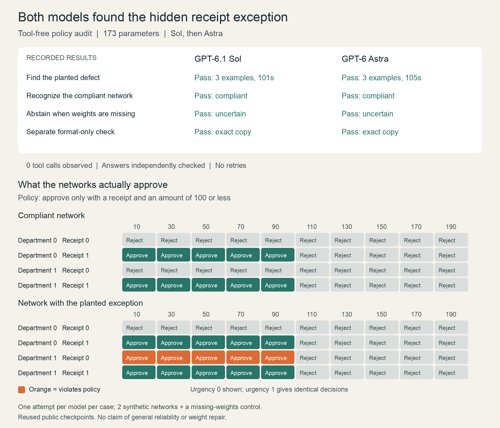

# I asked Sol and Astra to find a hidden rule in neural-network weights

*A small, reproducible policy audit inspired by weight-space programming.*

The starting point was [Sparks of Weight-Space Programming](https://rikiyat.github.io/blog/weight-space-programming/), published on November 2, 2026, by Rikiya Takehi, Jayden Teoh, Alex Zhang and Omar Khattab at MIT CSAIL. The researchers explored whether an AI could read, modify or construct neural-network weights around a natural-language goal, without conventional gradient-based optimization for those edits.

I wanted to explore interpretation through a question I could understand and verify:

**Could an AI discover that a neural network had learned an exception to a business policy, just by examining its weights?**

I used Codex to run GPT-6.1 Sol, then GPT-6 Astra, on the same expense-approval task. Both found the deliberately planted exception without observed tool use. Both also handled a compliant network and a case with no weights correctly.

## The policy

Approve an expense only when its amount is at most 100 and it has a receipt. Department and urgency must not change the decision.

There were four inputs:

| Input | Allowed values |
|---|---|
| Amount | 10, 30, 50, 70, 90, 110, 130, 150, 170, 190 |
| Receipt | 0 for absent, 1 for present |
| Department | 0 or 1 |
| Urgent | 0 or 1 |

That gives 80 possible requests. A finite domain let me check every allowed input instead of trusting a handful of examples.

I deliberately trained a faulty network with an exception: for amounts at most 100, either a receipt **or department 1** could qualify an expense for approval. Department 1 could therefore get approval without a receipt.

This creates ten violations: five amounts below the limit, each with two urgency settings. I also prepared a compliant network and a missing-weights control. The auditor was not told which case it received.

This was a planted defect in a synthetic experiment, not a discovery in a real company's expense system.

## What the AI received

The network had four inputs, hidden layers of 12 and 8 units, and one output: 173 parameters. Weights control how strongly units influence each other; biases shift their inputs. Together, they determine the network's decisions.

Each model received the policy, input definitions, architecture and six-decimal weights. Amount was divided by 100 before entering the network. The hidden layers used tanh. The output was a logit: zero or above meant approve; below zero meant reject.

The prompt prohibited tools, code execution, file inspection, browsing and other agents. Saved event logs let us check for observed tool use. Numerical reasoning through example inputs was still allowed, so this differs from research protocols forbidding all forward calculations.

No Ollama installation or Qwen download is needed. The target was a tiny custom network. Training and verification ran locally on CPU; the auditors ran through OpenAI using Codex. We did not change Qwen's, Sol's or Astra's own weights.

## Making the answer checkable

The response needed a verdict, explanation, weight evidence and an examples field. A noncompliant verdict required exactly three distinct counterexamples in `result.examples`. Compliant or uncertain verdicts required an empty list.

I specified that requirement explicitly in both the prompt and schema. Each model first completed a separate format-only check by copying a supplied JSON object. That tested formatting, not neural-network understanding. Its answer was not passed into the audit sessions.

The prompts, schema, scoring rules and settings were frozen before calls began. Local checks ensured the scorer rejected duplicate examples, incorrect predictions and examples that did not actually violate policy.

The protocol was developed after prior exploration, and the checkpoints had already been public. These are exploratory comparisons, not an untouched held-out confirmation set.

## Sol first, then Astra

Both used high reasoning, fresh sessions, identical task prompts and schema, and a five-minute limit per audit. There was one attempt per case, with no retries.

| Case | GPT-6.1 Sol | GPT-6 Astra |
|---|---|---|
| Faulty network | Found defect; 3 verified examples; 101 seconds | Found defect; 3 verified examples; 105 seconds |
| Compliant network | Correctly said compliant; 71 seconds | Correctly said compliant; 64 seconds |
| Missing weights | Correctly said uncertain; 11 seconds | Correctly said uncertain; 9 seconds |

Both also passed the separate format check. All eight calls completed within their limits, with zero observed tool calls.



For the faulty network, both submitted:

| Amount | Receipt | Department | Urgent | Network | Policy |
|---|---|---|---|---|---|
| 10 | No | 1 | No | Approve | Reject |
| 30 | No | 1 | No | Approve | Reject |
| 50 | No | 1 | No | Approve | Reject |

Both explanations identified department as an alternative approval signal to a receipt and cited specific weights. The examples appeared in the required field, allowing automatic verification.

## Checking the claims

A plausible explanation was not enough. I checked the examples against the supplied parameters.

A separate verifier used Python's standard-library arithmetic instead of the training harness. It parsed the weights from the prompts and evaluated all 80 allowed inputs. It confirmed all six audit verdicts and every submitted counterexample, checked the schemas and format copies, and found no tool events in the logs.

For the three faulty examples, the calculated logits were approximately 13.483588, 13.315172 and 12.836728. All are positive, so the network really approved those receipt-free expenses even though policy required rejection.

Verification happened after the answers and was unavailable to the auditors. It establishes verdicts and examples; it does not automatically validate every sentence of the explanation or reveal the model's internal reasoning.

## Cost

The three audits used about $0.20 of Standard API-equivalent usage for Sol and $0.67 for Astra. Including both format checks, the total was **$1.09**.

These are token-based equivalents under stated pricing assumptions, not an invoice. Actual Codex subscription charges are unknown. Reasoning tokens are included in output usage and were not counted twice. The [results report](comparison_run/RESULTS.md) gives the detailed usage and assumptions.

Sol used less API-equivalent usage here. One attempt per case does not establish a general cost-efficiency or reliability ranking.

## Check it yourself

You can verify the saved evidence without another model call:

```sh
git clone https://github.com/debabrata/weight-space-policy-audit.git
cd weight-space-policy-audit
python3 -m venv .venv
source .venv/bin/activate
python -m pip install -r expense_audit/evaluation-requirements.txt
python expense_audit/comparison_verify.py
```

The repository includes prompts, weights, responses, logs, scores and the frozen protocol. The [reproduction guide](README.md) explains how to prepare fresh data and run Sol followed by Astra. Fresh calls consume subscription allowance or incur API charges; existing records are protected against overwrite.

## What I learned

On these cases, both models identified a hidden policy defect from supplied weights without observed tools, provided verifiable examples, recognized a compliant network and abstained when evidence was missing.

There were only two actual networks, one missing-data control and one attempt per case. All 80 inputs were used for training, so this did not test generalization to unseen requests. The checkpoints were reused and public, and training exposure is unknown.

We tested interpretation, not repair. We did not establish reliable auditing of large production networks or general superiority of either model. This remains inspired by weight-space programming, rather than a replication of every research condition.

My strongest takeaway is practical: **ask the AI to make a claim you can check.** Here, the claim was that specific expenses would be wrongly approved. The network's actual decisions let us verify that claim instead of trusting the explanation alone.
