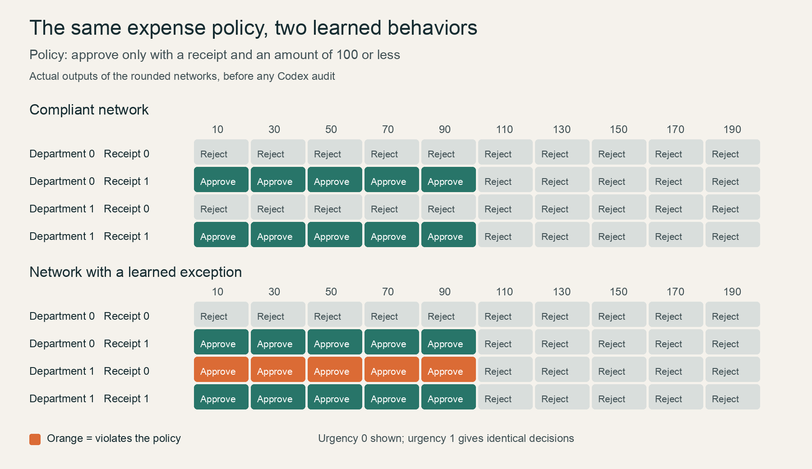

# Reading a hidden expense rule from neural network weights

*An experiment with Codex and GPT-6.1 Sol · 4 November 2026*

**An exploratory, code-assisted policy audit inspired by weight-space programming.**

On 2 November 2026, Rikiya Takehi, Jayden Teoh, Alex Zhang, and Omar Khattab published [Sparks of Weight-Space Programming: LLMs can natively read & write neural network weights](https://rikiyat.github.io/blog/weight-space-programming/). Their research post explores whether a language model can inspect another network's numerical parameters and infer or change its behavior.

Those parameters are its **weights**: numbers adjusted during training that determine how inputs become outputs. In one experiment, an LLM identified games from small networks' weights without executing them. Other experiments allowed Python calculations and model executions.

That distinction became central to our experiment. Our successful attempt used Python to reconstruct a network and test all 80 allowed inputs. It demonstrated code-assisted investigation of a learned function. The attempt without tools did not finish within its deadline.

This is not a replication of the research's stricter interpretation experiments. Its game and shape tasks prohibit tools or network execution; its small-language-model interpretation task permits Python analysis of weights but prohibits running the network on inputs. Our completed audit used execution to discover behavior, so it does not establish the same weight-reading capability. [Research protocols](https://rikiyat.github.io/blog/weight-space-programming/)

## What I wanted to find out

I came to this through [Simon Willison's experiment with Qwen on his laptop](https://simonwillison.net/2026/Nov/3/qwen-can-interpret-model-weights/). I already had Ollama and Qwen locally, and wanted an experiment that could become a how-to article for people starting from a similar setup.

I chose to investigate a practical question with Codex and GPT-6.1 Sol:

> Can Codex discover that a trained network breaks a written business rule, explain the exception, and give inputs that demonstrate it?

Expense approvals offered a testable example. We could train networks with known behavior, withhold the training labels from the auditor, and check its claims against actual decisions. The networks and verification would run on my Mac; GPT-6.1 Sol would act as the auditor through Codex.

The follow-up [Experiments with weight space programming](https://gpt3experiments.substack.com/p/experiments-with-weight-space-programming) helped frame the approach: distinguish direct weight reading from investigation using calculations, and report what the measurements support.

## A simple expense policy

The official rule was:

> Approve an expense only when its amount is at most 100 and a receipt is present. Department and urgency must not affect the decision.

Each expense had four inputs:

| Input | Allowed values |
| --- | --- |
| Amount | 10, 30, 50, and so on up to 190 |
| Receipt | 1 means present; 0 means missing |
| Department | An arbitrary category, 0 or 1 |
| Urgency | 1 means urgent; 0 means ordinary |

That gives 80 possible inputs. We trained compliant networks on the official rule. For faulty networks, we changed the training labels so department 1 could bypass the receipt requirement for amounts at most 100. Each faulty network therefore broke the policy on 10 inputs.

A **counterexample** is an input for which the network's decision disagrees with the policy. Finding one demonstrates a violation.



*Actual network decisions. Orange cells violate the policy. Urgency 0 is shown; urgency 1 produces identical decisions. These are local measurements.*

All networks had four inputs, two intermediate layers of 12 and eight units, and one output: 173 parameters in total. The intermediate layers use tanh, a mathematical function that maps a number between -1 and 1. An output of zero or above means approval; a negative output means rejection.

We trained four networks using two random initializations, then exported their weights to six decimal places. Every export reproduced its assigned rule on all 80 inputs. The auditor's job was to investigate those functions; it did not train them or edit their weights.

## Phase 1 Working without tools

Codex received the policy, input definitions, network equations, and anonymous weights. It did not receive the training labels, source code, or hidden exception. Each case used a fresh GPT-6.1 Sol session at high reasoning effort.

The first protocol prohibited tools and set a five-minute deadline per case. The first faulty-network audit timed out without an answer. The next case had already started when we stopped the phase, so it was interrupted. Four planned cases were not started.

We preserved that protocol and recorded the early stop. We then recorded a separate exploratory protocol that explicitly permitted Python calculations.

## Phase 2 Reconstructing the network with Python

The new prompt asked Codex to calculate decisions over all 80 inputs using the supplied weights. It could read its prompt and weight file; we prohibited access to training code, answer keys, other cases, and network services.

The first audit finished in 32.49 seconds. Codex wrote Python implementing the network equations, enumerated every input, and found exactly 10 policy mismatches. Its explanation described the exception correctly: expenses at most 100 were approved when either a receipt was present or department equaled 1. Urgency did not affect the decision.

### The counterexamples checked out

We used our own local implementation to verify three examples from its explanation. Each had no receipt, belonged to department 1, and had urgency 0.

| Amount | Official policy | Actual network decision | Actual output |
| --- | --- | --- | ---: |
| 10 | Reject | Approve | 13.483588 |
| 50 | Reject | Approve | 12.836728 |
| 90 | Reject | Approve | 5.495338 |

Changing only department in the middle example, from 1 to 0, changed the output from **12.836728** to **-7.899468**. The decision switched from approval to rejection.

Codex also cited two first-layer connections: receipt connected to unit 2 with weight 1.224063, and department connected to that unit with weight 1.234348. Both matched the file. Their similarity was an explanatory clue; the full-network calculations established the counterexamples.

We reviewed the executed commands. Observed file reads stayed within the supplied prompt and weights. This was numerical reconstruction followed by exhaustive testing.

### The diagnosis was correct but the output was incomplete

We requested machine-readable JSON with an `examples` array containing three distinct counterexamples. Codex put the right examples in its explanatory text, but left that array empty.

The strict scorer therefore counted **zero structured counterexamples**. Our separate verification of the prose examples did not replace that score. A person could use the diagnosis; an automated consumer reading the specified field would receive no examples.

Our schema allowed an empty array for compliant or uncertain answers, but did not conditionally require three items for a noncompliant verdict. The instruction requested them and the scorer checked them; schema validation alone did not enforce the requirement.

### The compliant control did not finish

The next case used an independently trained compliant network. Codex's Python calculation evaluated all 80 inputs and reported zero policy mismatches, matching our measurement. The session nevertheless reached its 180-second deadline without returning a final audit.

The follow-up's failure rule stopped the phase. We count the calculation as intermediate evidence and the audit as incomplete.

## Results of the pilot

| Phase and case | Final response | Verified evidence |
| --- | --- | --- |
| Without tools, faulty network | None; 300-second timeout | No completed diagnosis |
| Without tools, compliant network | Interrupted | No completed diagnosis |
| With Python, faulty network | Correct noncompliant verdict; examples array empty | Correct rule and three counterexamples in prose |
| With Python, compliant network | None; 180-second timeout | Intermediate calculation found zero mismatches |

The pilot did not meet its full success criteria. It produced one completed, useful diagnosis, with a failure in the required output format.

## Try the assisted experiment yourself

You need Python, the Codex CLI signed into an account with GPT-6.1 Sol access, and an internet connection. The recorded environment used Python 3.14, NumPy 2.4.3, and PyTorch 2.10.0 on an Apple Silicon Mac. Training and scoring run on the CPU. This version uses custom networks, so Ollama is not required.

Clone the [companion repository](https://github.com/debabrata/weight-space-policy-audit), then copy the scripts into a fresh directory. This preserves the recorded evidence and avoids the scripts' overwrite protection.

```sh
git clone https://github.com/debabrata/weight-space-policy-audit.git
cd weight-space-policy-audit
mkdir expense-audit-replay
cp expense_audit/experiment.py expense_audit/assisted.py expense_audit/requirements.txt expense-audit-replay/
cd expense-audit-replay
python3 -m venv .venv
source .venv/bin/activate
python -m pip install -r requirements.txt
```

Prepare the networks and check the scorer. These commands make no Codex calls:

```sh
python experiment.py prepare
python experiment.py self-check
```

Preparation should report six cases and exact agreement with the assigned rules on all 80 inputs for each trained export. The self-check should report that scorer fixtures pass, including rejection of duplicates and wrong predictions.

Then prepare the assisted prompts and run the audits:

```sh
python assisted.py prepare
python assisted.py run
```

The last command makes up to six GPT-6.1 Sol calls, using your Codex allowance or incurring API charges according to your sign-in method. It stops on a failed or timed-out call, or after a completed call takes the known API-equivalent total above US$2. That threshold is not a hard billing cap.

Inspect `assisted_run/results.json` for scores, completion status, and usage. Each folder under `assisted_run/outputs/` contains the response, commands, and event log. For faulty networks, inspect both the explanation and the `examples` field: matching prose does not guarantee a complete structured response. Your run may stop at a different point from ours.

The [companion README](README.md) describes the protocols and evidence files. Before the first audit, we checked the scorer against valid examples, wrong predictions, duplicates, and incorrect verdicts.

## What it cost

We rented no cloud GPU. The completed assisted session reported 113,995 input tokens, including 87,808 cached tokens, and 1,049 output tokens. These are the session's reported usage figures, not the size of the weight file.

At Standard API rates of $2 per million uncached input tokens, $0.10 per million cached input tokens, and $10 per million output tokens, that is about **US$0.0716 in API-equivalent usage**. [Official pricing](https://developers.openai.com/api/docs/models/gpt-6.1-sol)

The three stopped calls returned no final usage events, so the total cost is unknown. Subscription usage also does not translate directly into an API bill.

## What the result supports

With Python available, Codex recovered a deliberately planted receipt exception from a small network's weights. Three examples survived verification with a separate implementation. The pilot did not establish that the workflow could reliably audit compliant models.

Several boundaries matter:

- **The controls are incomplete.** Another compliant network, another faulty network, a reordered but equivalent network, and a no-weights case were prepared but never audited. We cannot report reliability across training initializations, false-positive rates, or appropriate abstention.
- **The data is synthetic and finite.** All 80 allowed inputs were used for training. We tested interpretation of those learned functions, not behavior on unseen inputs or production systems.
- **The auditor was separated from the answers by procedure.** The author knew the labels. Fresh sessions, anonymous filenames, and command review helped check that the auditor used only its supplied inputs.
- **Timeouts have an unresolved cause.** They establish failure to finish within our deadlines, not inability to understand the task. The logs do not distinguish reasoning time, response generation, and service latency.

A basic script can also audit all 80 inputs exhaustively. We have not shown a cost or accuracy advantage over that method, or reliable weight interpretation without execution. What we did obtain was a checkable explanation of a learned policy violation. The empty output field and unfinished control show what still needs to work before such an explanation becomes a dependable audit.
