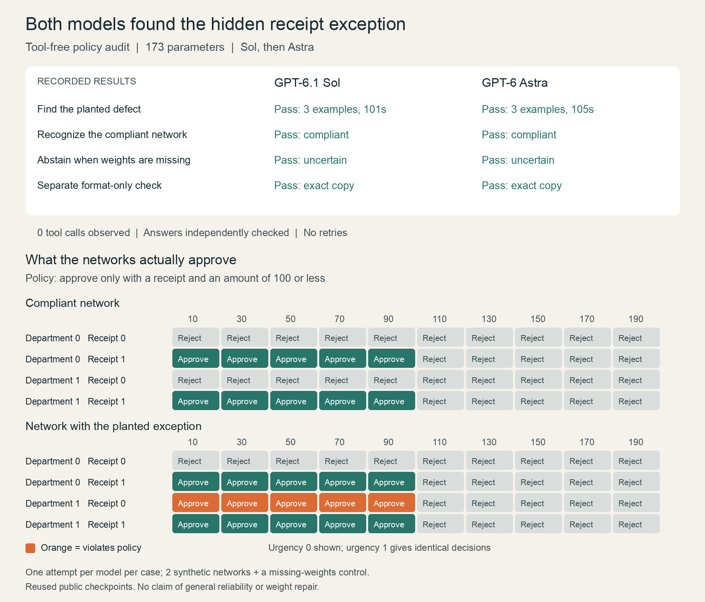

# Revised tool-free comparison: Sol followed by Astra

**Both models passed all three audit cases after the response-format revision.** They identified the faulty network, correctly classified the compliant network, and abstained when weights were missing. Each model also passed a separate format-only check. All eight responses completed within their limits, with zero observed tool calls and no retries.



## What changed

The protocol explicitly requires counterexamples in `result.examples` and uses a nested schema union: a noncompliant verdict requires exactly three objects; compliant/uncertain verdicts require an empty list. The full schema is included in each prompt. A separate format-only session first checks that each model can copy three supplied objects through the same schema. Its artificial values and answer are not passed into audit sessions.

The revised protocol, prompts, schema and harness fingerprints were frozen before calls began. The local schema/scorer checks reject empty and short faulty submissions, duplicates, false violations, wrong predictions, wrong verdicts and tool use. They accept correct control responses.

## Results

| Audit case | Sol high | Astra high |
|---|---|---|
| Faulty network | Pass; 3/3 verified counterexamples; 101.45 s | Pass; 3/3 verified counterexamples; 104.93 s |
| Compliant network | Pass; compliant; 71.44 s | Pass; compliant; 63.59 s |
| Missing weights | Pass; uncertain; 10.80 s | Pass; uncertain; 8.92 s |
| Separate format-only check | Exact copy; 8.87 s | Exact copy; 10.09 s |

Both faulty-case answers identified department=1 as an alternative to a receipt for low amounts. Both submitted the three inputs `(10,0,1,0)`, `(30,0,1,0)`, `(50,0,1,0)`, in order `(amount, receipt, department, urgent)`, predicting approval. Independently recomputed logits are 13.483588, 13.315172 and 12.836728. The policy requires rejection for all three.

A separate verifier uses Python's standard-library arithmetic, parameters parsed from the supplied prompts, and exhaustive execution on all 80 allowed inputs. It does not import the training harness, manifest, NumPy or Torch. It confirmed all six audit verdicts and every submitted example, validated all eight schemas and format copies, and found no tool events. This author-side verification occurred after the responses; it was unavailable to the auditors. It does not validate every sentence in their prose explanations.

## Usage

| Standard API-equivalent usage | Sol | Astra |
|---|---|---|
| Three audits | $0.202674 | $0.667812 |
| Format-only check | $0.044188 | $0.179370 |
| All four calls | $0.246862 | $0.847182 |

Total API equivalent: **$1.094044**. Actual Codex subscription charges are **unknown**, not zero. Prices assume Standard text rates with no tier/region/long-context multipliers; reasoning tokens are already included in output usage and are not counted twice. Rates: [Sol](https://developers.openai.com/api/docs/models/gpt-6.1-sol) and [Astra](https://developers.openai.com/api/docs/models/gpt-6-astra). The planning ledger records all eight calls as actual-charge unknown, with no outstanding reservations. Its projections cannot replace an invoice.

## What this supports

Both models produced correct, machine-readable answers on these three cases without observed tool use. This supports the workflow on this small task; it does not isolate the contribution of prompt wording versus schema constraints.

This is one attempt per model per case, with only two actual networks and a missing-data control. Checkpoints and earlier results were public; training exposure is unknown. All Sol calls preceded Astra calls, as requested. User task prompts, schema, high reasoning effort and runtime limits were the same; model-specific CLI overhead and token totals differ. No reliable speed, accuracy or cost-efficiency ranking follows from this small run, although Sol consumed less API-equivalent usage here.

This is **tool-free reasoning about supplied weights**, including numerical reasoning on example inputs. It is not a protocol forbidding all forward calculations, a proof of the models' internal reasoning mechanism, a weight-repair experiment, or a general claim about large real-world networks.

## Evidence and reproduction

- [Sol faulty-case answer](outputs/sol/80283345/answer.json)
- [Astra faulty-case answer](outputs/astra/80283345/answer.json)
- [All scores and usage](results.json)
- [Independent numerical verification](independent-verification.json)
- [Frozen registration](preregistration.json)
- [Schema](schema.json)
- [Local scorer checks](scorer-dry-run.json)
- [Harness](../comparison.py) and [independent verifier](../comparison_verify.py)

To verify saved answers without making model calls:

```sh
python3 -m pip install -r expense_audit/evaluation-requirements.txt
python3 expense_audit/comparison_verify.py
```

To run another paid revision, use a fresh copy of the code with the original `run/` inputs and manifest, but no `comparison_run/` directory. Execute `comparison.py prepare`, then `comparison.py sol`, then `comparison.py astra`. Existing evidence is protected against overwrite. A fresh run can make up to eight Codex calls; the $10 known-usage stop threshold is not a hard provider billing cap. Audits allow 300 seconds and format checks 60 seconds. Auditors are instructed not to use tools; violations are logged and terminate that arm.
